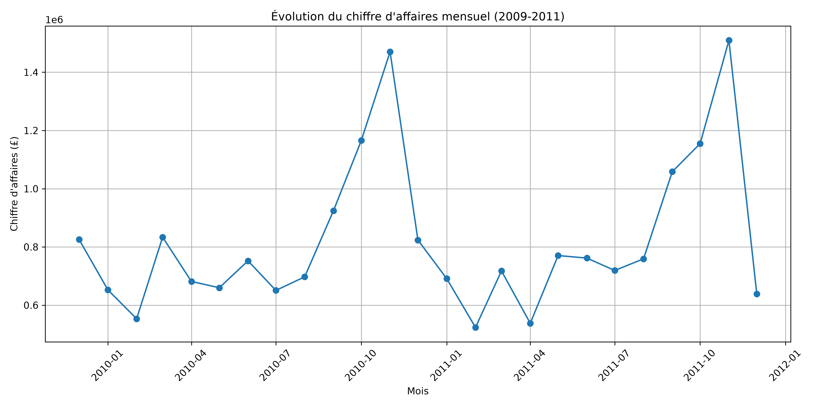
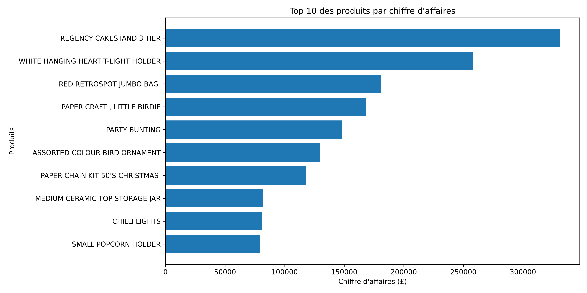
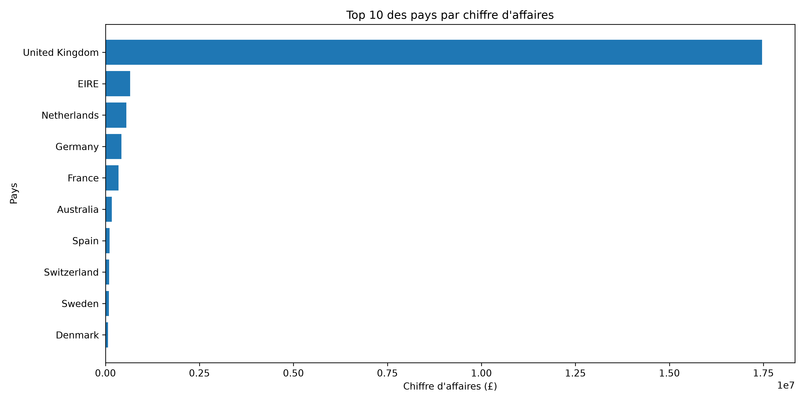

# Analyse de données e-commerce avec SQL et Python

### Projet personnel — Data Marketing & Analyse des ventes

## 1. Présentation du projet

J'ai réalisé ce projet personnel dans le but de développer mes compétences en analyse de données et de mettre en pratique SQL et Python sur un cas concret lié au marketing.

Pour cela, j'ai travaillé sur un jeu de données historique de ventes e-commerce, comprenant des transactions réalisées entre décembre 2009 et décembre 2011.

Les données contiennent notamment les références des produits, les quantités achetées, les prix, les dates de transaction, les identifiants clients et les pays de vente.

Mon objectif était de partir de ces données brutes pour construire une analyse des performances commerciales et identifier quelques tendances intéressantes d'un point de vue marketing.

J'ai organisé mon travail autour de trois questions :

- Comment le chiffre d'affaires évolue-t-il au fil des mois ?
- Quels produits génèrent le plus de chiffre d'affaires ?
- Quels pays contribuent le plus aux ventes ?

Ce projet m'a permis de travailler sur les différentes étapes d'une analyse : préparation des données, requêtes SQL, calcul d'indicateurs, visualisation et interprétation des résultats.

## 2. Outils utilisés

| Outil | Utilisation |
|---|---|
| PostgreSQL | Stockage, nettoyage et analyse des données |
| pgAdmin 4 | Exécution des requêtes SQL |
| Python | Création des analyses et des graphiques |
| Pandas | Lecture et manipulation des fichiers CSV |
| Matplotlib | Visualisation des résultats |
| VS Code | Écriture et exécution du code |

J'ai utilisé SQL pour préparer les données et calculer les indicateurs, puis Python pour transformer les résultats en graphiques plus faciles à lire.

## 3. Les données utilisées

Le projet repose sur deux fichiers de transactions e-commerce :

- Un premier fichier couvrant la période 2009-2010.
- Un deuxième fichier couvrant la période 2010-2011.

Au total, les deux fichiers contiennent **1 067 371 lignes** avant traitement.

Chaque ligne correspond à une référence produit présente dans une transaction. Une même facture peut donc apparaître sur plusieurs lignes lorsqu'un client achète plusieurs articles.

Les principales informations disponibles sont :

| Variable | Description |
|---|---|
| Invoice | Numéro de facture |
| StockCode | Référence du produit |
| Description | Nom du produit |
| Quantity | Quantité |
| InvoiceDate | Date de la transaction |
| Price | Prix unitaire |
| Customer ID | Identifiant client |
| Country | Pays associé à la transaction |

Ces informations permettent d'étudier les ventes selon plusieurs dimensions : le temps, les produits et les marchés géographiques.

## 4. Préparation et nettoyage des données avec SQL

Avant de réaliser les analyses, j'ai commencé par explorer les deux tables dans PostgreSQL.

Cette étape était importante, car les données brutes contenaient plusieurs éléments susceptibles de fausser les résultats.

### Vérification de la qualité des données

J'ai effectué différentes requêtes pour repérer :

- Les identifiants clients manquants.
- Les descriptions de produits absentes.
- Les quantités négatives ou nulles.
- Les prix nuls ou négatifs.
- Les factures correspondant à des annulations.

J'ai notamment constaté que certaines transactions présentaient des quantités négatives et que plusieurs factures d'annulation commençaient par la lettre `C`.

Pour l'analyse du chiffre d'affaires des ventes positives, j'ai donc choisi de conserver uniquement les lignes dont la quantité et le prix étaient strictement positifs, en excluant également les factures d'annulation.

### Traitement du chevauchement entre les fichiers

Les deux fichiers couvraient en partie la même période, au début du mois de décembre 2010.

En les réunissant directement, certaines lignes auraient été comptées deux fois.

J'ai donc comparé les données des deux tables afin de repérer les lignes communes, puis utilisé une requête SQL permettant de traiter ce chevauchement tout en conservant les répétitions présentes à l'intérieur de chaque fichier.

**22 523 occurrences de lignes identiques** ont ainsi été identifiées entre les deux sources.

Après ce traitement, le jeu de données réunifié contenait **1 044 848 lignes**.

### Création d'une vue pour les analyses

J'ai ensuite créé une vue SQL appelée `ventes_finales` afin de travailler sur une base cohérente pour l'ensemble des requêtes.

J'y ai également ajouté une colonne calculée :

**Chiffre d'affaires = Quantité × Prix unitaire**

Après application des filtres retenus, la vue contenait **1 019 654 lignes de ventes**.

Cette étape m'a permis de réutiliser les mêmes données préparées pour toutes les analyses suivantes.

## 5. Analyse des performances commerciales

Une fois les données préparées, j'ai réalisé plusieurs requêtes SQL pour calculer les principaux indicateurs.

### Indicateurs globaux

| Indicateur | Résultat |
|---|---:|
| Lignes des fichiers d'origine | 1 067 371 |
| Lignes après traitement du chevauchement | 1 044 848 |
| Lignes de ventes conservées | 1 019 654 |
| Chiffre d'affaires des ventes positives | 20 537 741,92 £ |
| Nombre de factures distinctes | 40 077 |

Le chiffre d'affaires calculé représente environ **20,54 millions de livres sterling** sur la période étudiée.

Il correspond uniquement aux ventes positives retenues après nettoyage. Les retours et les annulations étant exclus, ce montant ne doit pas être interprété comme un chiffre d'affaires net comptable.

Le nombre de factures distinctes donne également une indication sur le volume de commandes, même si une facture peut contenir plusieurs références produits.

## 6. Évolution du chiffre d'affaires dans le temps

Pour étudier l'activité commerciale, j'ai regroupé les ventes par mois avec SQL, puis exporté les résultats dans un fichier CSV.

J'ai ensuite utilisé Pandas et Matplotlib pour créer un graphique présentant l'évolution du chiffre d'affaires mensuel.

### Ce que j'observe

Le chiffre d'affaires varie sensiblement d'un mois à l'autre.

Deux périodes ressortent particulièrement :

- **Novembre 2010**, avec environ **1,47 million £** de chiffre d'affaires.
- **Novembre 2011**, avec environ **1,51 million £**.

Les ventes augmentent également à l'automne, notamment entre septembre et novembre.

Cette évolution laisse apparaître une saisonnalité commerciale, avec une activité plus importante à l'approche de la fin d'année.

Il faut toutefois tenir compte du fait que les données s'arrêtent au 9 décembre 2011. La baisse visible sur le dernier mois ne peut donc pas être interprétée comme une baisse réelle des performances sur un mois complet.

### Intérêt marketing

Cette analyse peut être utile pour réfléchir au calendrier des campagnes commerciales.

Si une entreprise observe régulièrement une hausse de ses ventes sur certaines périodes, elle peut chercher à anticiper cette demande en préparant ses actions marketing, ses stocks ou ses communications.

Dans ce jeu de données, l'automne apparaît comme une période particulièrement intéressante à approfondir.

## 7. Analyse des produits

J'ai ensuite cherché à identifier les références qui généraient le plus de chiffre d'affaires.

Pour cela, j'ai regroupé les ventes par code produit, puis calculé le montant total associé à chaque référence.

J'ai exclu trois codes particuliers (`M`, `DOT` et `POST`) correspondant à des lignes de frais ou d'ajustements, afin de concentrer le classement sur les produits.

### Ce que j'observe

Le produit **Regency Cakestand 3 Tier** arrive en première position avec environ **331 000 £** de chiffre d'affaires.

Il est suivi du **White Hanging Heart T-Light Holder**, qui représente environ **258 000 £**.

Plusieurs références liées à la décoration et aux accessoires pour la maison apparaissent dans le classement.

Ces résultats montrent que certaines références occupent une place importante dans les ventes.

Il est toutefois important de distinguer le chiffre d'affaires du nombre d'unités vendues : un produit peut générer un chiffre d'affaires élevé grâce à son prix, à ses volumes de vente ou à une combinaison des deux.

### Intérêt marketing

Ce classement permet de repérer les produits qui contribuent le plus au chiffre d'affaires.

Il pourrait servir de point de départ pour :

- Identifier les références à mettre en avant dans certaines campagnes.
- Étudier les produits qui mériteraient des recommandations complémentaires.
- Comparer les produits les plus performants selon les périodes.

Une analyse plus poussée pourrait également s'intéresser aux quantités vendues et aux associations de produits dans les paniers.

## 8. Analyse géographique des ventes

Pour la dernière partie, j'ai regroupé le chiffre d'affaires par pays afin de comprendre la répartition géographique de l'activité.

J'ai ensuite représenté les dix principaux pays dans un graphique réalisé avec Python.

### Ce que j'observe

Le **Royaume-Uni** représente de loin la plus grande partie des ventes, avec environ **17,47 millions £**, soit près de **85 % du chiffre d'affaires total**.

Les principaux marchés suivants sont :

| Pays | Chiffre d'affaires approximatif |
|---|---:|
| Royaume-Uni | 17,47 M£ |
| Irlande | 659 000 £ |
| Pays-Bas | 554 000 £ |
| Allemagne | 426 000 £ |
| France | 351 000 £ |

La différence entre le Royaume-Uni et les autres pays est particulièrement importante.

Les ventes internationales existent donc, mais elles représentent une part nettement plus faible de l'activité.

### Intérêt marketing

Cette répartition montre une forte concentration des ventes sur le marché britannique.

D'un point de vue marketing, cela peut amener à se poser plusieurs questions :

- Quels pays présentent le plus fort potentiel de développement ?
- Les comportements d'achat sont-ils différents selon les marchés ?
- Certains produits fonctionnent-ils mieux dans certains pays ?
- Faut-il adapter les campagnes et les offres selon les zones géographiques ?

Les données disponibles ne suffisent pas à répondre à toutes ces questions, mais elles permettent d'identifier des pistes d'analyse.

## 9. Ce que j'ai appris avec ce projet

Ce projet m'a permis de mieux comprendre le déroulement d'une analyse de données, depuis l'importation des fichiers jusqu'à la présentation des résultats.

Sur la partie SQL, j'ai travaillé sur les filtres, les agrégations, les regroupements, les dates, les vues et le traitement de données communes à plusieurs fichiers.

Sur la partie Python, j'ai appris à importer des résultats SQL sous forme de CSV, à les manipuler avec Pandas et à créer des graphiques avec Matplotlib.

J'ai aussi compris l'importance des choix effectués pendant le nettoyage : selon les lignes conservées ou exclues, les indicateurs calculés peuvent être différents.

Enfin, j'ai essayé de ne pas m'arrêter aux chiffres, mais de réfléchir à ce qu'ils pouvaient signifier dans un contexte marketing.

## 10. Limites et pistes d'amélioration

Cette analyse présente plusieurs limites.

D'abord, les données sont historiques et ne représentent pas les performances actuelles d'une entreprise.

Ensuite, le chiffre d'affaires étudié repose uniquement sur les ventes positives. Les retours et les annulations ne sont pas intégrés dans le montant présenté.

Le traitement du chevauchement entre les deux fichiers repose sur la comparaison de lignes identiques. Cette méthode permet de limiter les doubles comptages, mais elle ne garantit pas de distinguer toutes les transactions réelles ayant exactement les mêmes caractéristiques.

Par ailleurs, certains mois sont incomplets, ce qui limite les comparaisons directes.

Enfin, les coûts des produits ne sont pas disponibles. Il n'est donc pas possible de calculer leur rentabilité.

Pour aller plus loin, plusieurs analyses pourraient être intéressantes :

- Étudier le panier moyen.
- Comparer les quantités vendues et le chiffre d'affaires par produit.
- Analyser la fréquence d'achat des clients identifiés.
- Réaliser une segmentation RFM (récence, fréquence, montant).
- Étudier les comportements d'achat selon les pays.

Ces pistes permettraient d'orienter davantage le projet vers la connaissance client et le CRM.

## 11. Organisation du projet

Le dépôt contient les fichiers SQL et Python utilisés pour réaliser les analyses, ainsi que les résultats exportés et les graphiques.

| Fichier | Contenu |
|---|---|
| `analyse_retail.sql` | Requêtes SQL de préparation et d'analyse |
| `analyse_marketing.py` | Script Python de création des graphiques |
| `data-1795279675058.csv` | Résultats mensuels exportés depuis SQL |
| `top_10_produits.csv` | Classement des produits |
| `top_10_pays.csv` | Classement des pays |
| `evolution_ca.png` | Évolution du chiffre d'affaires |
| `top_10_produits.png` | Graphique des produits |
| `top_10_pays.png` | Graphique des pays |

## Conclusion

Ce premier projet m'a permis de mettre en pratique SQL et Python sur des données commerciales et de mieux comprendre comment passer de données brutes à une analyse exploitable.

Au-delà des aspects techniques, j'ai particulièrement apprécié le fait de pouvoir relier les résultats à des problématiques marketing : saisonnalité, performance des produits et répartition des ventes selon les marchés.

C'est une première étape dans mon apprentissage de l'analyse de données appliquée au marketing, que je souhaite poursuivre avec des projets davantage orientés vers la connaissance client et le CRM.